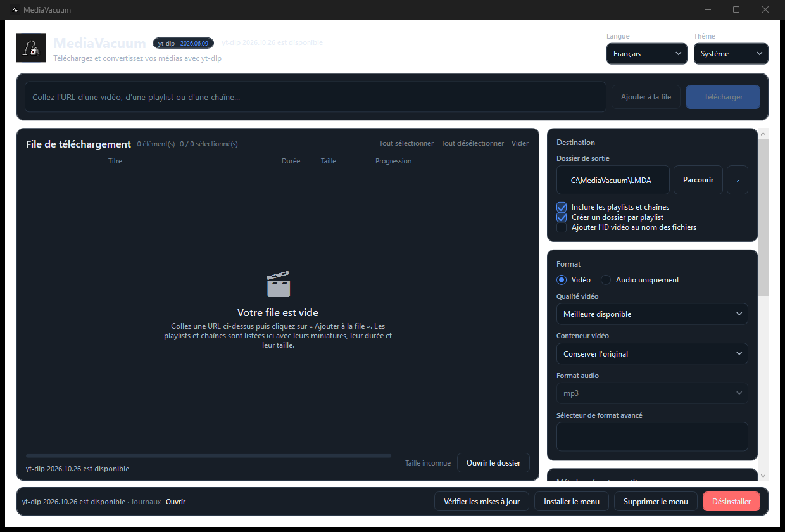
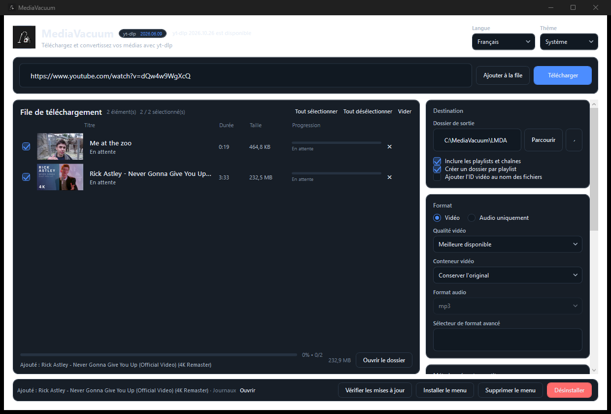

<div align="center">

# MediaVacuum

**A modern Windows GUI for [yt-dlp](https://github.com/yt-dlp/yt-dlp)**

[](https://github.com/frarthur/media-vacuum/releases/latest)
[](https://github.com/frarthur/media-vacuum/releases)
[](https://dotnet.microsoft.com/)
[](LICENSE)

</div>

---

**Personal message :**

I built this project because I was tired of opening a terminal every time I wanted to use yt-dlp. I wanted something lightweight, native to Windows, and easy enough that anyone could use it without learning command-line arguments.

---

MediaVacuum wraps [yt-dlp](https://github.com/yt-dlp/yt-dlp) into a clean Windows desktop application. Paste a video, playlist or channel URL, review the queue with thumbnails and sizes, then download with per-item progress. `yt-dlp.exe` and `ffmpeg` are managed by the application when needed.

## Features

- **Queue first, download later** — adding a URL analyses it and lists every video before anything is downloaded
- **Playlists & channels** — thumbnails, duration, size estimates, per-item progress and total size
- **Clean filenames** — invalid characters and duplicate spaces are removed; playlists use `01 - Title` numbering in their own folder
- **Video & audio formats** — quality presets, MP4/MKV/WebM containers, MP3/M4A/AAC/FLAC/Opus/Vorbis/WAV/ALAC, plus a custom yt-dlp format selector
- **Thumbnails** — embedded in the media, with an optional sidecar image file
- **Light / dark themes** — System, Light or Dark, applied live
- **5 languages** — English, French, Spanish, German and Russian
- **FFmpeg assistant** — detects an existing ffmpeg build or downloads one (~80 MB) when a conversion needs it
- **Explorer context menu** — right-click a folder (or its background) → _Download media_
- **yt-dlp auto-update** — checks GitHub on startup, replaces `yt-dlp.exe` when a newer release is available
- **JavaScript runtime support** — detects Deno, Node, Bun and QuickJS for YouTube, with an optional Deno download
- **MediaVacuum self-update** — checks GitHub on startup, replaces the executable and restarts automatically
- **Portable** — a single self-contained Windows x64 executable
- **Safe uninstall** — removes only MediaVacuum data, never your downloads or an arbitrary parent folder

## Screenshots





## Quick Start

1. Download the latest `MediaVacuum.exe` from [Releases](https://github.com/frarthur/media-vacuum/releases/latest)
2. Run it — `yt-dlp.exe` is downloaded automatically on first launch if needed
3. Paste a URL, click **Add to queue**, review the list, then click **Download**

> The context menu can be installed with **Install menu** in the footer. It is a per-user registry entry (`HKCU`), so no elevation is required.

## How the queue works

1. Paste a URL and press Enter (or click **Add to queue**).
2. MediaVacuum asks yt-dlp for the media information.
   - A single video becomes one queue entry.
   - A playlist or channel becomes one entry per video, with its thumbnail, duration and estimated size.
3. Review the list, uncheck videos you do not want, then click **Download**.
4. Each entry shows its own progress, speed, remaining time and final filename. The footer shows the overall progress and the total known/estimated size.

Size estimates are refined in the background when **Estimate sizes before downloading** is enabled. For very large channels this can take a while; the total is also updated while downloading. Before starting, MediaVacuum checks the free space on the output drive and asks for confirmation if the estimated size is larger than the available room (with a safety margin).

## Thumbnails and VLC

When **Embed thumbnail** is enabled, MediaVacuum runs yt-dlp with `--embed-thumbnail --convert-thumbnails jpg`:

- **Audio files (MP3, M4A, FLAC, …):** VLC displays the embedded cover art.
- **Video files (MP4, MKV, WebM):** the cover is embedded in the file, but **VLC does not display embedded cover art for video playback**. This is a VLC limitation, not a missing download. Other players and some Explorer views may show it.
- To keep an image next to the media as well, enable **Keep a thumbnail file next to the media**; it produces a sidecar `.jpg` file.

## MediaVacuum updates

On startup, MediaVacuum checks the latest release of the application on GitHub. When a newer version is available, it:

1. downloads the `MediaVacuum-<version>-win-x64.zip` release asset (SHA-256 verified when GitHub provides a digest),
2. extracts the new `MediaVacuum.exe`,
3. starts a small updater that waits for the current process to exit,
4. replaces the executable and relaunches MediaVacuum.

The feature is enabled by default and can be disabled with **Install MediaVacuum updates automatically** in the advanced settings. When disabled, an update link appears in the header and can be clicked manually.

> The application must be able to write to the folder containing `MediaVacuum.exe` (portable installs in a user folder work; a protected `Program Files` folder may require manual replacement). Your configuration and downloads are not modified by an update.

## JavaScript runtime (YouTube)

Recent yt-dlp versions need a JavaScript runtime to solve YouTube challenges and expose all formats. MediaVacuum detects **Deno**, **Node**, **Bun** and **QuickJS** on the PATH (and in its own `js` folder), then passes `--js-runtimes` to yt-dlp automatically.

If no runtime is installed, the advanced settings offer a **Download Deno** button (~40 MB). A missing runtime is a common cause of incomplete YouTube format lists or `HTTP Error 403: Forbidden`.

## FFmpeg

Merging separate video/audio streams, extracting audio, embedding thumbnails and changing containers require **ffmpeg**. MediaVacuum looks for `ffmpeg.exe` in:

1. the configured path,
2. `%LOCALAPPDATA%\MediaVacuum\ffmpeg`,
3. the application folder / current folder,
4. the Windows `PATH`.

If it is missing, the application offers to download an official build (gyan.dev, with a BtbN fallback) into `%LOCALAPPDATA%\MediaVacuum\ffmpeg`.

## Video and audio formats

- Video quality presets produce valid yt-dlp selectors such as `bv*[height<=1080]+ba/b[height<=1080]`
- Containers: keep original, MP4, MKV, WebM (remux) or MP4 with re-encoding when necessary
- Audio: MP3, M4A, AAC, FLAC, Opus, Vorbis, WAV, ALAC
- A custom format expression can override the preset (for example `bv*[height<=720]+ba/b`)

## Filenames

Filenames are built from the media title after removing Windows-invalid characters, control characters and duplicate whitespace. Playlists get a folder named after the playlist and numbered entries:

```
Output/
└── My playlist/
    ├── 01 - First video.mp4
    └── 02 - Second video.mp4
```

The optional **Add the video ID to filenames** setting appends `[videoId]` to avoid collisions.

## Languages

| Flag | Code | Language | File |
| ---- | ---- | -------- | ---- |
| 🇬🇧 | `en` | English | [en.json](src/MediaVacuum.Core/Translations/en.json) |
| 🇫🇷 | `fr` | French | [fr.json](src/MediaVacuum.Core/Translations/fr.json) |
| 🇪🇸 | `es` | Spanish | [es.json](src/MediaVacuum.Core/Translations/es.json) |
| 🇩🇪 | `de` | German | [de.json](src/MediaVacuum.Core/Translations/de.json) |
| 🇷🇺 | `ru` | Russian | [ru.json](src/MediaVacuum.Core/Translations/ru.json) |

Translations are embedded in the executable. Advanced users can override individual keys by creating `%LOCALAPPDATA%\MediaVacuum\Translations\<lang>.json` with `"_overrides": "true"` plus the keys to replace. Unmarked files (from older versions) are ignored so updates are not shadowed.

## Installation from source

```powershell
git clone https://github.com/frarthur/media-vacuum.git
cd MediaVacuum
dotnet run --project src/MediaVacuum
```

Requires the **.NET 9 SDK**.

## Build a release

```powershell
.\publish.ps1
```

The script produces `publish/MediaVacuum.exe` (single-file, self-contained, win-x64) and `MediaVacuum-<version>-win-x64.zip`.

Create a GitHub release:

```powershell
gh release create v0.2.1 --title "v0.2.1" --notes-file RELEASE_NOTES.md .\MediaVacuum-0.2.1-win-x64.zip
```

## Command line

```powershell
MediaVacuum.exe                 # normal start
MediaVacuum.exe --install       # install the Explorer context menu
MediaVacuum.exe --uninstall     # remove the Explorer context menu
MediaVacuum.exe --folder "C:\Media" --url "https://..."
```

The Explorer context menu passes the clicked folder with `--folder`, which pre-fills the output directory.

## Architecture

```
MediaVacuum/
├── src/
│   ├── MediaVacuum/                 # WPF UI (MVVM, themes, services)
│   │   ├── App.xaml / App.xaml.cs
│   │   ├── MainWindow.xaml / .cs
│   │   ├── Services/               # dialogs, theme, thumbnails, app services
│   │   ├── Styles/                 # Common.xaml, Light.xaml, Dark.xaml
│   │   ├── ViewModels/             # MainViewModel, QueueItemViewModel, commands
│   │   ├── Converters/
│   │   └── Utilities/
│   ├── MediaVacuum.Core/           # business logic, no WPF dependency
│   │   ├── Models/
│   │   ├── Services/               # yt-dlp, queue, self-update, updates, ffmpeg, translations
│   │   ├── Utilities/              # format selector, filename sanitizer, sizes
│   │   └── Translations/           # embedded JSON catalogues
│   └── MediaVacuum.Installer/      # Explorer context menu, safe data cleanup
├── tests/MediaVacuum.Tests/        # xUnit tests
├── publish.ps1
├── Directory.Build.props           # shared version 0.2.1
├── ROADMAP.md
└── LICENSE
```

Built with **.NET 9 / WPF / MVVM**. The Core project has no WPF dependency and is covered by unit tests (filenames, format selectors, progress parsing, playlist mapping, translations, config, version comparison).

## Data locations

| Path | Contents |
| ---- | -------- |
| `%LOCALAPPDATA%\MediaVacuum\config.json` | Settings |
| `%LOCALAPPDATA%\MediaVacuum\yt-dlp.exe` | Managed yt-dlp binary |
| `%LOCALAPPDATA%\MediaVacuum\ffmpeg\` | Optional ffmpeg build |
| `%LOCALAPPDATA%\MediaVacuum\js\` | Optional Deno runtime |
| `%LOCALAPPDATA%\MediaVacuum\thumbnails\` | Queue thumbnail cache |
| `%LOCALAPPDATA%\MediaVacuum\logs\app.log` | Application log |
| `%LOCALAPPDATA%\MediaVacuum\updates\` | Downloaded MediaVacuum update |
| `%LOCALAPPDATA%\MediaVacuum\Translations\` | Optional user translation overrides |

## Known limitations

- VLC does not show embedded cover art for **video** files (see above).
- On Windows 11, the classic Explorer context menu may appear under **Show more options**.
- Downloading a very large channel can produce a long queue; analysis and size estimation take time.
- Some sites require cookies or authentication; MediaVacuum does not manage accounts or cookies yet.
- YouTube may still return `403 Forbidden` for age-restricted, region-restricted or bot-checked videos even with an up-to-date yt-dlp and a JavaScript runtime; cookies are not managed yet.
- Automatic MediaVacuum replacement requires write access to the folder containing the executable.

---

## Credits

- **[yt-dlp](https://github.com/yt-dlp/yt-dlp)** — This application is a graphical wrapper around yt-dlp. All downloading capabilities are powered by yt-dlp, which is licensed under the [Unlicense](https://github.com/yt-dlp/yt-dlp/blob/master/LICENSE). yt-dlp is a fork of [youtube-dl](https://github.com/ytdl-org/youtube-dl).
- **[FFmpeg](https://ffmpeg.org/)** — Optional post-processing and conversion engine. See the [FFmpeg legal page](https://ffmpeg.org/legal.html) for the license of the downloaded build.
- MediaVacuum is **not** affiliated with yt-dlp, YouTube or FFmpeg. It is simply a user-friendly interface for the underlying tools.

---

> MediaVacuum is provided as-is, without any warranty. Respect copyright laws and the terms of service of the websites you download from.
